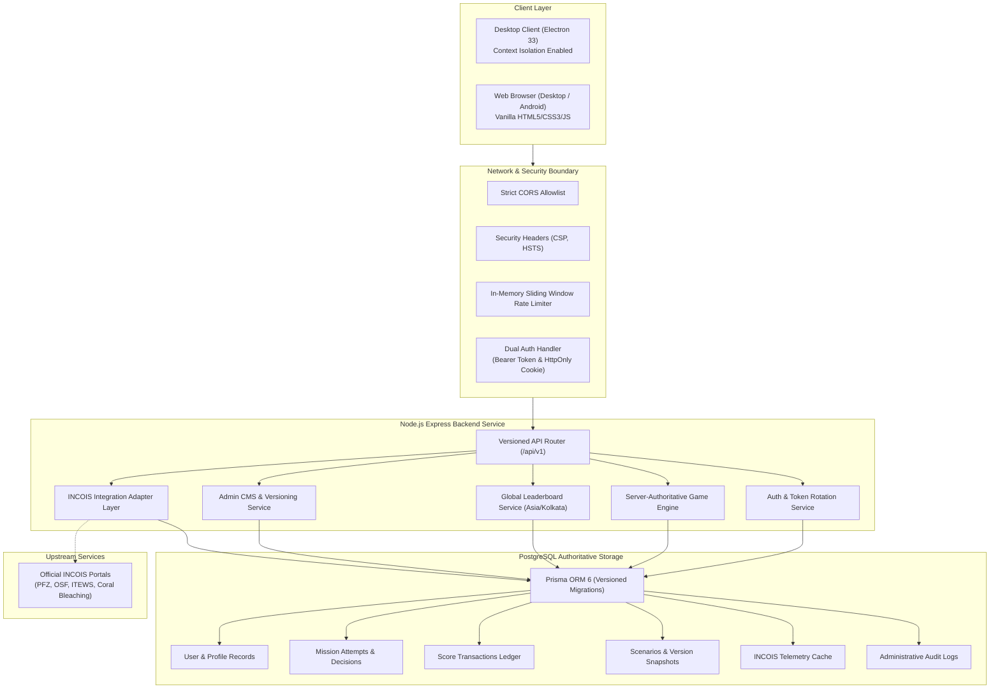
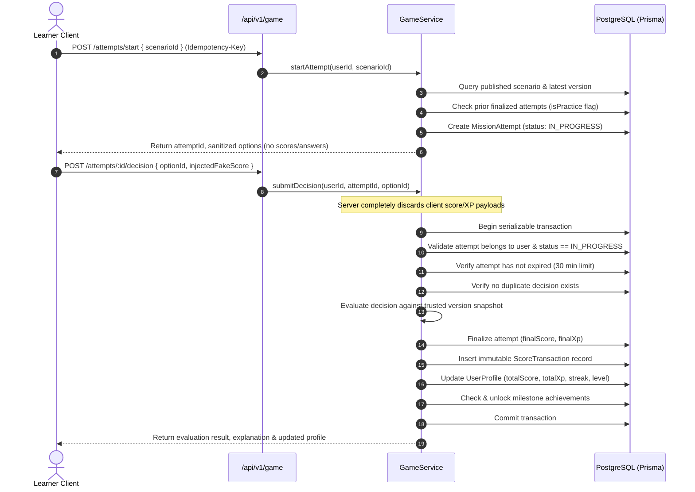

# Ocean Literacy Platform — Phase 2 Architecture Specification

```
===================================================================================
  OCEAN LITERACY PLATFORM — SYSTEM ARCHITECTURE OVERVIEW (PHASE 2 PRODUCTION)
===================================================================================
```

## 1. Executive Summary

The **Ocean Literacy Platform (Phase 2)** transforms an educational single-player desktop decision game into a scalable, multi-user, server-authoritative web and desktop platform. The system is engineered for future hosting and operational governance by the **Indian National Centre for Ocean Information Services (INCOIS)** under the **Ministry of Earth Sciences (MoES), Government of India**.

---

## 2. Core Architectural Principles

1. **Server Authoritative Security**: The client (Electron desktop, browser, or mobile viewport) is completely untrusted. Scores, XP, level progression, and leaderboard ranks are calculated, recorded, and validated exclusively inside PostgreSQL transactions on the backend.
2. **Framework-Free Vanilla Renderer**: Retains the zero-overhead, responsive HTML5, CSS3, and Vanilla JavaScript frontend architecture without introducing heavy frameworks (React, Next.js).
3. **Dual Client Support**: Simultaneously powers the packaged Electron desktop application (via Node-isolated context bridges) and standard web browsers (desktop/Android) using unified REST endpoints.
4. **Resilient Data Governance**: INCOIS operational information integrations feature strict provenance tracking, service-specific caching TTLs, fallback fixtures, and mandatory disclaimers separating educational simulation models from genuine operational hazard bulletins.
5. **Zero-Downtime Content Publishing**: Scenarios are managed, draft-validated, and versioned via an integrated Admin Content Management System (CMS), eliminating code edits or redeployments for routine educational updates.

---

## 3. High-Level Component Architecture



---

## 4. Subsystem Breakdown

### 4.1 Client Layer
- **Electron Desktop Application (`src/main/main.js`)**: Runs with `contextIsolation: true`, `nodeIntegration: false`, and `sandbox: true`. Interacts strictly through `src/preload/preload.js`.
- **Vanilla JavaScript Renderer (`src/renderer/js/`)**:
  - `services/apiClient.js`: Unified API client managing JWT access credentials, bearer tokens, retryable network queues, and graceful offline fallback.
  - `modules/authModal.js`: Handles registration, login, profile view, password resets, and DPDP Act data export/erasure.
  - `modules/gameModule.js`: Dual-mode gameplay controller handling online server-authoritative attempts and offline educational practice.
  - `modules/adminModule.js`: Embedded Admin CMS providing draft authoring, validation, previewing, and scenario publishing.
- **Responsive Layout**: Designed for 320px mobile viewports up to 4K displays with high-contrast ocean aesthetics, CSS glassmorphism, and full keyboard navigation.

### 4.2 Backend & Security Boundary (`server/src/`)
- **Express 4.21 Application**: Modular architecture separating routing, controller dispatch, business logic services, and persistence.
- **Middleware Pipeline**:
  1. `helmet`: Content Security Policy, X-Frame-Options, HSTS, noSniff.
  2. `cors`: Explicit origins allowlist (`http://localhost:3000`, `app://-`). No wildcard credentialed CORS.
  3. `rateLimiter`: Protects against brute-force attacks (5 attempts/15min on login/register; 120 req/min on public APIs).
  4. `authMiddleware`: Extracts JWT credentials from either `Authorization: Bearer <token>` or HttpOnly session cookie.
  5. `errorHandler`: Centralized error envelope emitting sanitized messages without stack traces or SQL fragments.

### 4.3 Database Architecture (PostgreSQL 16 + Prisma)
- Authoritative state repository containing 18 relational models.
- UTC standard timestamping with `Asia/Kolkata` (IST) leaderboard window calculations.
- Immutable ledger pattern for score transactions (`ScoreTransaction`), preventing destructive overwrites and enabling audits.

---

## 5. Key System Flows

### 5.1 Server-Authoritative Decision Evaluation


### 5.2 Immutable Scenario Versioning (CMS)
When an authorized Administrator or Content Editor modifies a published mission:
1. The server checks `prisma.missionAttempt.count({ where: { scenarioVersionId } })`.
2. **If attempts count == 0**: Modifies the draft in place.
3. **If attempts count > 0**: Freezes the historical version and automatically branches into a new snapshot (`versionNumber: N + 1`, `status: DRAFT`).
4. Historical attempts remain permanently anchored to their original snapshot, preserving auditable integrity.

---

## 6. Offline & Network Degradation Strategy

| Operational State | Indicator | Platform Behavior |
| :--- | :--- | :--- |
| **Authenticated Online** | 🟢 Live Connected | Authoritative missions loaded from DB, decisions evaluated by server, scores entered into global leaderboards. |
| **Guest / Offline Mode** | 🟡 Offline Practice | Educational scenarios loaded from local cache; decisions scored provisionally; clear badge indicating score is non-competitive. |
| **Temporary Disconnect** | 🟠 Reconnecting | In-progress attempts can be resumed via `/attempts/:id/resume` upon network restoration within the 30-minute expiry window. |
| **API Unavailable** | 🔴 Service Outage | Gracefully falls back to local UNESCO educational modules and explains server maintenance status. |
