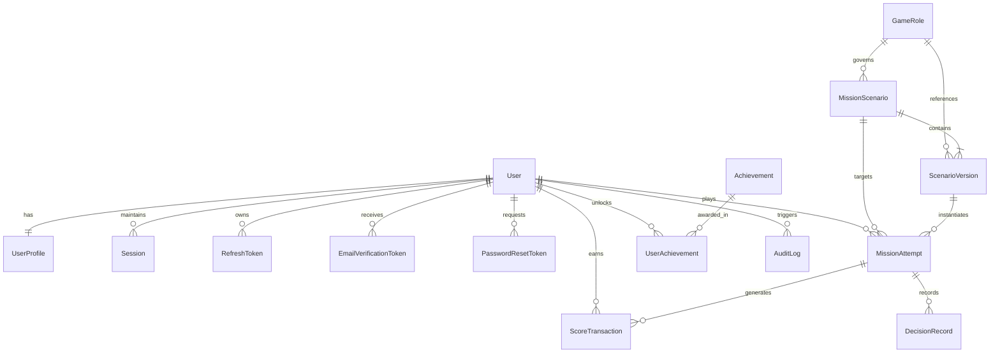

# Ocean Literacy Platform — Database Architecture & Schema Specification

```
===================================================================================
  OCEAN LITERACY PLATFORM — POSTGRESQL & PRISMA ORM SPECIFICATION (PHASE 2)
===================================================================================
```

## 1. Overview & Principles

The authoritative data store for the **Ocean Literacy Platform** is PostgreSQL 16+, managed declaratively using **Prisma ORM** migrations. The database schema enforces:
- **Referential Integrity**: Cascading and set-null rules across relational entities.
- **Strict Anti-Tampering**: Immutable transaction ledgers (`ScoreTransaction`) and immutable scenario versions (`ScenarioVersion`).
- **UTC Authoritative Timestamps**: All timestamps stored in UTC (`DateTime` / `TIMESTAMPTZ`) and aggregated deterministically against the `Asia/Kolkata` timezone for Indian standard reporting.
- **Sanitized Seed Data**: Seeding scripts populate standard reference metadata (5 roles, 6 achievements, 4 INCOIS configurations, 15 version-1 scenarios) without injecting fake users or fraudulent leaderboard records.

---

## 2. Entity-Relationship Data Model



---

## 3. Schema Model Definitions

### 3.1 Authentication & User Governance
- **`User`**: Core identity model.
  - `id`: UUID (Primary Key)
  - `email`: String (Unique, Indexed)
  - `passwordHash`: String (Bcrypt work factor 12 / Argon2id)
  - `role`: Enum (`LEARNER`, `CONTENT_EDITOR`, `ADMIN`, default `LEARNER`)
  - `isActive`: Boolean (Account suspension flag)
  - `isEmailVerified`: Boolean
  - `leaderboardOptIn`: Boolean (DPDP privacy consent, default `true`)
  - `createdAt`, `updatedAt`: DateTime UTC
- **`UserProfile`**: Gamified statistics and progress.
  - `userId`: UUID (Unique, Foreign Key -> `User.id` ON DELETE CASCADE)
  - `callsign`: String (Public player name)
  - `activeRoleId`: String (Current occupation, e.g. `fisher`, `captain`)
  - `totalScore`, `totalXp`, `level`: Integer
  - `currentStreak`, `maxStreak`, `hazardIncidents`, `missionsCompleted`: Integer
- **`Session` & `RefreshToken`**: Token rotation and session persistence.
  - `tokenHash`: SHA-256 digest of refresh token (Indexed)
  - `family`: UUID grouping token rotations for reuse detection
  - `isRevoked`: Boolean flag for immediate invalidation
  - `expiresAt`: DateTime UTC

### 3.2 Game Scenarios & Version Snapshots
- **`GameRole`**: Maritime occupations (`fisher`, `captain`, `tourism_operator`, `community_volunteer`, `conservation_ranger`).
- **`MissionScenario`**: Parent scenario record.
  - `id`: String (e.g. `scen-fisher-01`)
  - `roleId`: String (Foreign Key -> `GameRole.id`)
  - `status`: Enum (`DRAFT`, `PUBLISHED`, `ARCHIVED`)
  - `currentVersion`: Integer (Tracks active version pointer)
- **`ScenarioVersion`**: Immutable historical snapshot.
  - `id`: UUID
  - `scenarioId`: String (Foreign Key -> `MissionScenario.id`)
  - `versionNumber`: Integer
  - Unique Constraint: `@@unique([scenarioId, versionNumber])`
  - `title`, `region`, `topic`, `difficulty`, `objective`: Strings
  - `situationBriefing`, `simulationNotice`: Strings
  - `oceanConditions`, `options`, `scientificReferences`: JSONB payloads
  - `publishedBy`: UUID (Admin/Editor who authorized release)

### 3.3 Attempts, Decisions & Financial-Grade Ledger
- **`MissionAttempt`**: Represents a single playthrough.
  - `id`: UUID
  - `userId`: UUID (Foreign Key -> `User.id`)
  - `scenarioId`: String (Foreign Key -> `MissionScenario.id`)
  - `scenarioVersionId`: UUID (Foreign Key -> `ScenarioVersion.id`)
  - `status`: Enum (`IN_PROGRESS`, `FINALIZED`, `ABANDONED`, `EXPIRED`)
  - `idempotencyKey`: String (Unique, Indexed)
  - `isPractice`: Boolean (True if player previously finalized this mission)
  - `finalScore`, `finalXp`: Integer
  - `startedAt`, `expiresAt`, `finalizedAt`: DateTime UTC
- **`DecisionRecord`**: Individual decision submitted by player.
  - `attemptId`: UUID (Foreign Key -> `MissionAttempt.id`)
  - `optionId`: String
  - `isCorrect`, `isHazardous`: Boolean
  - `pointsDelta`, `xpDelta`: Integer
- **`ScoreTransaction`**: Authoritative immutable audit ledger.
  - `id`: UUID
  - `userId`: UUID (Indexed)
  - `attemptId`: UUID (Nullable)
  - `pointsDelta`, `xpDelta`: Integer
  - `reason`: String (`mission_decision`, `replay_practice_attempt`, `achievement_bonus_*`, `admin_moderation_adjustment`)
  - `createdAt`: DateTime UTC (Indexed with `userId` for fast temporal aggregations)

### 3.4 Operational Integrations & Audit Logging
- **`ExternalDataCache`**: Telemetry and advisory cache.
  - `serviceKey`: String (`pfz`, `osf`, `tsunami`, `marine_heatwave`)
  - `geographicScope`: String
  - `isSimulated`: Boolean
  - `sourceUrl`: String
  - `payload`: JSONB
  - `retrievedAt`, `expiresAt`, `forecastValidUntil`: DateTime UTC
- **`AuditLog`**: Administrative governance trail.
  - `userId`: UUID (Admin who performed action)
  - `action`: String (`MISSION_DRAFT_CREATED`, `MISSION_PUBLISHED`, `USER_ROLE_CHANGED`, `LEADERBOARD_SCORE_MODERATED`)
  - `resourceType`, `resourceId`: String
  - `details`: JSONB
  - `ipAddress`, `userAgent`: String
  - `createdAt`: DateTime UTC

---

## 4. Database Indexes & Query Optimization

| Table | Index Columns | Purpose |
| :--- | :--- | :--- |
| `User` | `email` (UNIQUE) | O(1) login lookup |
| `RefreshToken` | `tokenHash` (UNIQUE), `family` | Token rotation & reuse invalidation |
| `MissionAttempt` | `idempotencyKey` (UNIQUE) | Replay & duplicate request protection |
| `MissionAttempt` | `userId, scenarioId, status` | Replay protection check (`isPractice`) |
| `ScoreTransaction` | `userId, createdAt` | Daily/weekly leaderboard period grouping |
| `ExternalDataCache`| `serviceKey, geographicScope` | Fast telemetry cache resolution |
| `AuditLog` | `userId, createdAt` | Administrative audit trail filtering |

---

## 5. Migration Management & Operations

### Initializing a Clean Database
```bash
cd server
npx prisma generate
npx prisma migrate dev --name init_phase2_schema
node prisma/seed.js
```

### Applying Migrations in Staging / Production
Never use `prisma migrate dev` in production. Always deploy versioned migrations:
```bash
npx prisma migrate deploy
```

### Emergency Rollback Procedure
If a migration fails during deployment:
1. Identify the failed migration version from the `_prisma_migrations` table:
   ```sql
   SELECT migration_name, rolled_back_at FROM _prisma_migrations;
   ```
2. Revert the database schema to the prior migration point using an explicit down script.
3. Mark the migration as rolled back in Prisma:
   ```bash
   npx prisma migrate resolve --rolled-back <migration_name>
   ```
4. Restart application containers with the previous stable image release.
